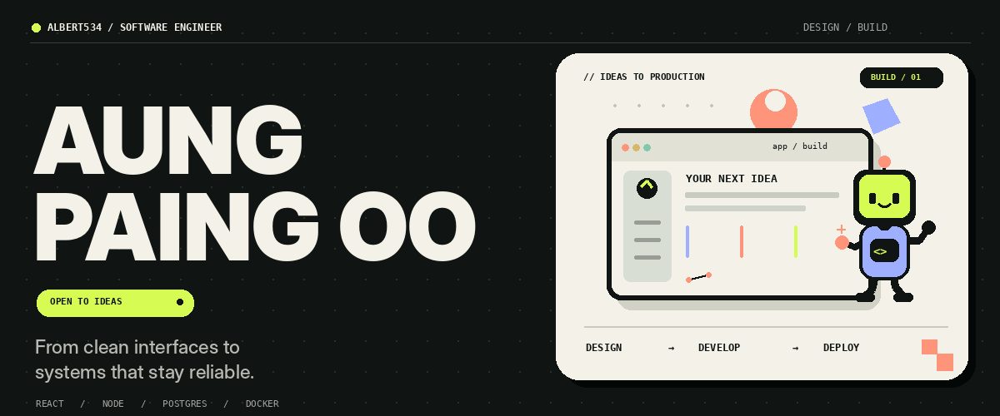
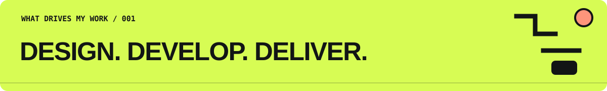

<!-- Aung Paing Oo · GitHub profile README · Original animation is local to this repository -->
<p align="center">
  
</p>

<p align="center">
  <b>Software Engineer</b> &nbsp;·&nbsp; Web &amp; Backend Engineering &nbsp;·&nbsp; Building toward AI &amp; Mobile
</p>

<p align="center">
  <a href="https://github.com/Albert534?tab=repositories">View my repositories</a>
  &nbsp;&nbsp; / &nbsp;&nbsp;
  <a href="https://github.com/Albert534">Follow my work</a>
</p>

<br/>

## Hello, world. I'm Aung 👋

I create software that feels considered on the surface and stays reliable underneath. I spend my time building **web applications, APIs, database-backed systems, and production workflows** — with an increasing focus on **Python automation, Flutter, and AI engineering**.

I'm interested in the whole product lifecycle: **design → build → deploy → improve**.

<br/>



<br/>

### 01 / What I work with

| Craft | Main tools |
| :--- | :--- |
| **Interface engineering** | React · Next.js · TypeScript · JavaScript |
| **Backend systems** | Node.js · Express.js · REST APIs · WebSockets |
| **Data & persistence** | PostgreSQL · Redis · Supabase |
| **Deployment & operations** | Docker · Nginx · Linux · Git |

### 02 / Where I'm heading

```text
NOW   Python automation        Build reliable workflows and integrations
NEXT  Flutter & Dart           Bring products to mobile
THEN  Applied AI engineering   Add useful intelligence to real software
```

### 03 / Principles

- **Build for people.** A fast interface is only useful if it makes sense.
- **Understand the system.** From API contract to database query to deployment.
- **Keep it maintainable.** Clear code, measurable performance, responsible security.
- **Ship and iterate.** Working software beats elaborate demos.

<details>
<summary><b>Open the engineering notebook →</b></summary>

```typescript
const engineer = {
  name: "Aung Paing Oo",
  handle: "@Albert534",
  focus: ["Web", "Backend", "Automation"],
  exploring: ["Flutter", "Applied AI"],
  mindset: "Design it. Build it. Make it better.",
};
```
</details>

---

<p align="center">
  <samp>GOOD SOFTWARE IS NOT AN ACCIDENT.</samp><br/>
  <sub>Designed and built for <a href="https://github.com/Albert534">@Albert534</a> · No fabricated stats or project claims.</sub>
</p>
